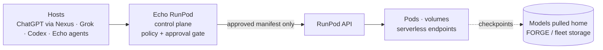

# Echo RunPod

Governed RunPod control plane for ECHO OMEGA PRIME. Version **1.1.1**.

One canonical policy source. Thin entry points for Grok, Codex, Echo agents,
and ChatGPT-via-Nexus. The control plane brokers Bob's RunPod account — GPU
types and live pricing, pods, volumes, serverless endpoints — for the long
27B adapter training runs and retrain loops, behind an approval gate with
cost ceilings.

## Default

Observe and prepare. Do not spend unless the Commander approved a manifest
or a bounded full lane is in force. Echo Nexus mutations require
`confirm: EXECUTE`.

Hard rules: docs first, checkpoint constantly, pull models home, no idle
money.

## Architecture

## ChatGPT / MCP

Dedicated resource (do **not** request `echo.write`): see `chatgpt/` and
`mcp_server/` for the MCP surface, `nexus/` for the Nexus entry point, and
`grok-operator/` for the Grok operator lane.

## Repo map

| Path | What it holds |
|---|---|
| `echo_runpod/` | The control-plane package (policy, client, launch gate) |
| `mcp_server/` | The MCP server entry point |
| `nexus/` | Echo Nexus integration |
| `chatgpt/` | ChatGPT host wiring |
| `grok-operator/` | Grok operator lane |
| `skills/` | The RunPod skill shipped to agent hosts |
| `scripts/` | Operational scripts |
| `tests/` | Test suite |
| `receipts/` | Launch/spend receipts — the audit trail |
| `DEPLOYMENT.md`, `DOWNLOAD.md` | Deployment notes; how trained models are pulled home |

## Related

- `echoomegaprime/echo-nexus` — the Nexus bridge the ChatGPT lane rides on.
- Personality Forge datasets and the 27B adapter queue live on FORGE; this
  plane is how their long runs get GPUs when the fleet's cards are busy.
